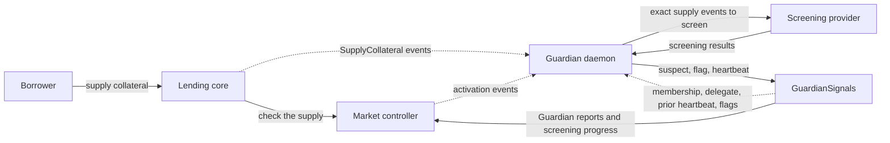
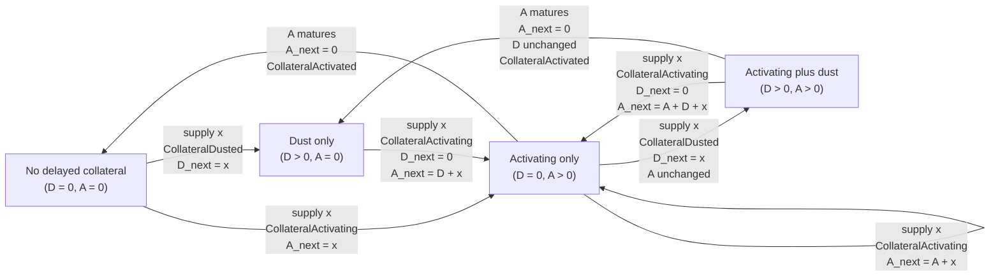

# Guardian daemon specification

> **Specification version:** `0.3.0` · **Previous version:** `0.2.0`
>
> **Changes from 0.2.0**
>
> - A `suspect` recorded since the previous heartbeat and still inside `suspectWindow` need not be sent again by a repeated attempt before that heartbeat; across heartbeats a fresh `suspect` is still required.
>
> **Changes from 0.1.0 to 0.2.0**
>
> - The `heartbeat` call and `Heartbeat` event now carry `bytes data`, which the registry emits unchanged without validating or storing it.
> - Every heartbeat must carry the deterministic 32-byte coverage digest defined by this specification. It commits to the complete reconstructed work set, including anchors excluded from provider screening because this Guardian had already flagged their target.
> - The digest encoding and anchor ordering are binding, including for an empty work set.

The lending protocol lets borrowers supply collateral to borrow. Collateral that enters delayed activation does not support borrowing immediately, giving Guardians time to screen its supply transaction before it becomes active. `GuardianSignals` records Guardian reports and screening progress onchain, giving market controllers the information they need to decide whether collateral can activate and whether a borrower can borrow.

A Guardian daemon performs this screening offchain. In each cycle, it selects a recent Ethereum block, finds the delayed collateral that must be reviewed by then, screens the relevant supply transactions, and submits any required `suspect` or `flag` reports.

After screening is complete and all required reports are confirmed, the daemon sends a heartbeat for the selected block. This tells controllers that the Guardian has completed all screening due through the end of that block. Because controllers use heartbeats to decide when delayed collateral can activate, sending one too early can allow unscreened collateral to become active. A controller uses heartbeats this way only while its `maxGuardiansQuorumDelay` is nonzero. With zero, delayed collateral activates at its base deadline whether or not it was screened, and this specification defines no procedure for such a market.

This document defines the behavior required of a Guardian daemon. [Appendix: Example Pseudocode](#appendix-example-pseudocode) shows one possible implementation. Other designs are valid if they identify and screen every supply transaction that requires review and confirm all required reports before sending the heartbeat.

## Components and data flow

The daemon reads protocol activity from the core and market controllers, but writes its reports and heartbeat only to `GuardianSignals`.



Dashed arrows show onchain data read by the daemon.

### GuardianSignals: identity, reports, and heartbeats

`GuardianSignals` represents the Guardian Committee as a set of registered addresses, one for each member. The contract stores each member's reports and heartbeat under its registered address.

After registration, the Guardian can call the contract directly or appoint one delegate with `setDelegate`. In the recommended setup, the registered address is a cold address (preferably a multisig), while the daemon signs routine transactions with a separate hot delegate. For report and heartbeat calls, the delegate passes the Guardian address as `onBehalf`, so their effects remain attached to the same committee member. Appointing a delegate does not register that address as another Guardian.

Only the registered Guardian can appoint, replace, or clear its delegate. Both the Guardian and its current delegate can call `suspect`, `flag`, `unsuspect`, `unflag`, and `heartbeat`. Because the delegate can also call `unsuspect` and `unflag`, a compromised delegate can retract the Guardian's reports.

A heartbeat is not scoped to one market. Before sending it, the daemon must complete the required screening through its reported block for every market in the configured core whose controller uses the configured registry. Each successful heartbeat records the Guardian's latest scanned timestamp. When enough Guardians report newer timestamps, `GuardianSignals` may advance the quorum frontier. Controllers use this frontier as one condition for activating delayed collateral. A controller stops waiting for the frontier once `maxGuardiansQuorumDelay` has elapsed since `activatingStart`, and does not wait for it at all when that value is zero. All other activation conditions still apply.

| Signature or type | Relevant contract behavior | Use in the daemon |
|---|---|---|
| `type Id is bytes32` | Identifies a market. | The daemon uses the market ID from the core in registry reads and writes. |
| `BlockInfoWithHash { bytes32 hash; uint40 number; uint40 timestamp; }` | Identifies the block reported by a heartbeat. | The daemon passes this value to `heartbeat` as `lastScannedBlock`. |
| `event GuardianAdded(address indexed guardian)` | Emitted when a Guardian joins the committee, including after the same address was removed and added again. | When no reusable heartbeat block exists, the daemon uses the latest event for the current membership only as the discovery anchor. |
| `isGuardian(address account) external view returns (bool)` | Returns whether `account` is a current Guardian at the queried block. Each write checks authorization again when the transaction runs. | The daemon stops the cycle if the configured Guardian is not a member. |
| `getDelegate(address guardian) external view returns (address)` | Returns the Guardian's current delegate. It returns the zero address when no delegate is set. | The daemon verifies that the onchain delegate equals the configured delegate. |
| `getHeartbeat(address guardian) external view returns (uint40 timestamp)` | Returns the stored heartbeat timestamp, or zero when no heartbeat exists. It does not return the reported block number or hash. | The daemon matches the stored timestamp to the latest `Heartbeat` event and chooses a report block with a greater timestamp. |
| `getFlaggedBy(Id marketId, address account) external view returns (address[] guardians)` | Returns the Guardians that have flagged the borrower. | The daemon treats this Guardian's existing flag as resolving the borrower's work anchors without provider screening. |
| `suspect(Id marketId, address onBehalf, address[] calldata accounts) external` | For Guardian `onBehalf`, records or refreshes a suspect report for every borrower in `accounts` in `marketId`. One Guardian counts once. A refresh stores the current block time. Suspect reports can add activation delay. They cannot ban a borrower. | The daemon submits suspect decisions in batches. |
| `flag(Id marketId, address onBehalf, address[] calldata accounts) external` | For Guardian `onBehalf`, adds a flag for every borrower in `accounts` in `marketId`. Repeating the same flag succeeds and changes nothing. Each new Guardian flag adds one strike. Each strike can add a configured delay. Reaching quorum can ban the borrower. | The daemon submits flag decisions in batches. |
| `heartbeat(address onBehalf, BlockInfoWithHash calldata lastScannedBlock, bytes calldata data) external` | For Guardian `onBehalf`, checks the sender and the reported block number, hash, and timestamp. The timestamp cannot be in the future or lower than the stored timestamp. The method stores only the timestamp and emits `data` unchanged in `Heartbeat`; it does not validate or store `data`. The method does not check that the timestamp matches the reported block header. | The daemon calls this method after every required signal is confirmed, passes the selected block's hash, number, and header timestamp, and passes the 32-byte coverage digest defined below as `data`. |
| `event Heartbeat(address indexed guardian, uint256 blockNumber, uint256 timestamp, bytes data)` | Emitted after a successful heartbeat. It contains the Guardian, block number, timestamp, and the caller-supplied `data`; it does not contain the block hash. Two events may use the same timestamp. | The daemon uses the event to find the previous report block and checks its timestamp against `getHeartbeat` and the block header. Independent monitoring uses `data` to verify the daemon's work set. |

### Core and controllers: supply and activation events

When a caller invokes `supplyCollateral()` on the lending core for the borrower named by `onBehalf`, the core calls the market controller, if configured, before increasing the borrower's collateral balance. A configured controller first tries to mature any ready existing `activating` balance, then classifies the new supply and emits its lifecycle event. The core then increases the collateral balance and emits `SupplyCollateral`.

The daemon treats each `SupplyCollateral` log as an exact supply anchor. It resolves the market controller from `id` and keeps the supply only when that controller's `guardianSignals()` returns `targetRegistry`. Only a supply that contributes to `activating` can become screening work, either directly or after its `dust` is absorbed by a later supply.

For one `(controller, borrower)`, all collateral in `activating` shares one base deadline, so the daemon must identify every supply that may contribute to that balance. In the graph, `D` is `dust`, `A` is `activating`, and `x` is the new supply.



`CollateralDusted` can be emitted only when `D` was zero before the supply, so at most one unresolved dust supply exists.

`CollateralDusted` does not change the base deadline. `CollateralActivating` sets the deadline when `activating` begins and may move it later, but never earlier. Maturation clears the stored timer.

A successful voluntary withdrawal either leaves the delayed buckets unchanged or clears both in full. If a forced seizure during `liquidate` or `settle` reaches delayed collateral, it removes `dust` before `activating` and may remove only part of either bucket. Any remaining `activating` keeps its base deadline; reaching zero clears the stored timer. A partial reduction of `activating` does not identify which supplies remain, so the daemon keeps every possible contributor anchor.

For each `(controller, borrower)`, the four controller lifecycle events record every change to `dust`, `activating`, and the stored base timer. Time passing and later configuration changes do not rewrite `Position`, so reconstruction follows these events, including those in transactions without `SupplyCollateral`. Each event contains the post-event `Position`.

| Signature or type | Meaning for the daemon |
|---|---|
| `event SupplyCollateral(Id indexed id, address indexed caller, address indexed onBehalf, uint256 assets)` | Exact supply anchor. `id` is the market and `onBehalf` is the borrower. |
| `marketController(Id id) external view returns (address)` | Returns the market controller, or zero when the market has none. |
| `guardianSignals() external view returns (address)` | Identifies the controller's registry. The daemon keeps only controllers that use `targetRegistry`. |
| `Position { uint128 dust; uint128 activating; uint40 activatingStart; uint32 activatingDelay; }` | Post-event bucket balances and the stored base timer. The base deadline is `activatingStart + activatingDelay`. |
| `event CollateralDusted(address indexed borrower, uint256 amount, Position position)` | `amount` is the new supply placed in `dust`. |
| `event CollateralActivating(address indexed borrower, uint256 amount, Position position)` | `amount` is added to `activating` and includes the new supply plus any absorbed dust. |
| `event CollateralActivated(address indexed borrower, uint256 amount, Position position)` | Does not add an activating contributor. The daemon uses its post-event `position` during reconstruction but does not derive a supply anchor from this event. |
| `event CollateralDrained(address indexed borrower, uint256 amount, Position position)` | `amount` is the inactive collateral removed. The daemon uses the post-event `Position` during reconstruction. |

For each supply retained by the registry filter, the daemon pairs `SupplyCollateral` with the controller lifecycle event at `supply.logIndex - 1`. The paired event must come from the resolved controller and name `supply.onBehalf` as its borrower. A separate `CollateralActivated` for an older lot may appear earlier in the same receipt. Each controller is bound to one market, so `(controller, borrower)` identifies one lifecycle history even though controller events omit `marketId`. The daemon takes `marketId` from `SupplyCollateral.id`.

### Screening provider

`ScreeningProvider` is the daemon's adapter to provider-specific screening logic. The daemon treats the adapter as a black box: its checks and its interpretation of provider-specific responses are outside the scope of this specification.

Each request identifies Ethereum mainnet, `reportBlock`, and the exact supply anchors. The adapter returns one result for every anchor. Each result states whether it is complete and whether it requires `suspect` or `flag`. It should also include an `evidenceReference` when available. This helps operators investigate the decision and reconstruct incident history.

`complete` means that the adapter returned a normalized decision for the anchor. A missing result or `complete == false` blocks the heartbeat. `evidenceReference` may be `NONE`; its absence does not block the heartbeat.

## Scan cycle

The Guardian must meet the scan cadence and reporting SLA agreed with Lido. Every required `suspect` or `flag` report must be confirmed within that SLA. Each cycle has five phases:

1. **Choose the coverage blocks.** The daemon selects a recent past block as `reportBlock` for the next heartbeat. It attempts to recover the previous heartbeat block from the latest `Heartbeat` event. It reuses that block only when the timestamp stored by `getHeartbeat(guardian)`, the event timestamp, and the reported block header timestamp all match. When no reusable heartbeat exists, the daemon leaves previous coverage empty and uses the latest `GuardianAdded` event for the current membership to anchor candidate discovery.

2. **Find candidate positions.** The daemon searches from `ACTIVATION_LOOKBACK_BLOCKS` before the reusable previous heartbeat block, or before the current membership's `GuardianAdded` block when there is no reusable heartbeat. Within that range, it collects positions from `CollateralActivating` events whose stored base deadline is no later than `reportBlock.timestamp`. When previous coverage exists, it includes positions that became base-due after that block and already-due positions that received a new `activating` contributor after that block.

3. **Build the work set.** The daemon reconstructs each candidate position at `reportBlock`. It discards a position whose state is not base-due. Otherwise, it finds every `SupplyCollateral` anchor that may still contribute to the position's `activating` balance. When previous coverage exists, it removes an anchor only when the position was already base-due at the previous heartbeat block and that anchor had entered `activating` by the end of that block. The remaining anchors form the work set. Anchors with the same `(marketId, borrower)` share one signal target. A signal target with at least one work anchor is a current-work target.

4. **Screen unresolved anchors.** For each current-work target, the daemon calls `getFlaggedBy(marketId, borrower)` at `reportBlock`. If this Guardian appears in the result, the daemon excludes every work anchor for that target from provider screening. It sends every work anchor for every remaining target to the configured screening provider and requires one complete result for each anchor before the heartbeat. Reports that complete results require may be sent before the remaining results are complete.

5. **Submit reports and, when required, the heartbeat.** With an empty work set, a heartbeat is due only when no stored heartbeat exists or `reportBlock.timestamp` is at least `idleHeartbeatInterval` later than the stored heartbeat timestamp. If a heartbeat is not due, the daemon finishes without a transaction. With a nonempty work set, the daemon groups the screening results by signal target. A target requires `suspect` or `flag` when at least one of its screened anchors requires that report. The daemon sends a fresh `suspect` for every target that requires one, even when an earlier report is still inside `suspectWindow`. The one exception is a repeated attempt before the heartbeat: a `suspect` that this Guardian recorded since its previous heartbeat need not be sent again while it is still inside `suspectWindow`. It sends every required `flag`; repeating an existing flag has no effect. After every report is confirmed, the daemon commits the complete work set in the heartbeat's `data` and sends the heartbeat for `reportBlock`. The cycle completes when that heartbeat is confirmed.

## Heartbeat requirements

`GuardianSignals` validates the sender and the reported block fields, but it cannot verify the daemon's offchain scan and does not interpret `data`. The daemon must pass a 32-byte coverage digest in this specification version. The digest must use the domain, ABI encoding and ordering defined by `computeCoverageDigest` in [Appendix D](#d-submit-signals-and-send-the-heartbeat). The digest commits to every anchor in the cycle's work set, including anchors excluded from provider screening because this Guardian had already flagged their target at `reportBlock`. A confirmed heartbeat is therefore the Guardian's attestation that all required work through `reportBlock` is complete.

Independent monitoring can rebuild the work set from Ethereum history, calculate the same digest, and compare it with `Heartbeat.data`. For the same coverage boundaries, a mismatch detects a missing, extra, or different anchor in the daemon's claimed work set. A matching digest does not prove that the screening provider examined an anchor or that its decision was correct.

The daemon may send the heartbeat only after:

- candidate discovery and contributor reconstruction finished with every requested log range returned successfully;
- every work anchor has one complete screening result, except anchors for a target that this Guardian had already flagged at `reportBlock`;
- every `suspect` or `flag` required by those results was submitted in this cycle or in an earlier attempt since the previous heartbeat, remains confirmed with at least `txConfirmationBlocks` confirmations and, for a `suspect`, is still inside `suspectWindow`.

Any other tool or person that sends a heartbeat for this Guardian makes the same attestation. Later cycles use that heartbeat as their previous coverage boundary and may skip earlier anchors. Removing a flag later does not make those anchors require screening again.

Immediately before broadcasting the heartbeat, the reference daemon checks every required report again at the current head. If a report is missing, failed, no longer canonical, or has fewer than `txConfirmationBlocks` confirmations, the daemon must not send the heartbeat until every required report is successful, canonical, and has at least `txConfirmationBlocks` confirmations, and the scan plan remains valid. Because reports and the heartbeat are separate transactions, a reorg beyond that confirmation depth can still remove a required report while leaving the heartbeat canonical.

## Secondary review and escalation

After the daemon submits a `suspect` or `flag` transaction and confirms that it succeeded onchain, the resulting report for each borrower enters a secondary review process defined by the Guardian. The process may be manual, automated, or combine both. It checks the provider decision and supporting evidence outside the scan cycle, so the heartbeat does not wait for it. The Guardian chooses the tooling and the handoff to this process.

This secondary review must reach a decision within the SLA agreed with Lido. The SLA must account for scan timing and market activation parameters, leaving enough time to confirm any follow-up transaction and, when needed, for other Guardians to act before the affected collateral can mature. This specification does not set its duration.

If the second opinion confirms the concern, the process follows the agreed Lido incident-response path and submits `flag` when only `suspect` exists. If it does not support the report, the process submits `unsuspect` or `unflag`.

`unflag` retracts the Guardian's report but does not lift an existing ban. Lifting the ban requires `unban` by an account with `ACCESS_RESTORER_ROLE`.

## Membership and delegate changes

A newly added Guardian starts with no delegate or stored heartbeat. If the daemon will use a delegate, the Guardian appoints it before the first cycle. A lot that began shortly before the Guardian joined may still be waiting for quorum progress when the first heartbeat is sent. The first cycle therefore starts candidate discovery `ACTIVATION_LOOKBACK_BLOCKS` before the `GuardianAdded` block for the current membership. This event is a search anchor, not previous coverage.

Changing the delegate preserves the Guardian's reports and stored heartbeat, so it does not reset coverage. After the daemon is configured to use the new signer, its next cycle continues from the same previous heartbeat.

Replacing a delegate does not invalidate its previous heartbeats or establish that the work they attest was performed. Delegate rotation alone does not restore trustworthy coverage after a compromise.

Before a Guardian is removed, its daemon must be stopped, any running scan plan discarded, and every pending daemon transaction resolved. Removal clears the delegate and stored heartbeat, while existing `suspect` and `flag` reports remain onchain. If the same address is added again, it is treated as a newly added Guardian and its new `GuardianAdded` event is used.

## RPC requirements

Each cycle relies on complete data from one consistent sequence of Ethereum blocks. Every older block used by the cycle must be an ancestor of every newer block, and one block number must not map to different hashes. The RPC layer must support block headers, historical `eth_getLogs`, and `eth_call` pinned to a block hash.

The runner is the application that runs the Guardian cycle and supplies its RPC access. The runner is responsible for selecting RPC sources and assessing the completeness and consistency of the history they provide. From an empty RPC response alone, the daemon cannot determine whether no logs matched or matching logs were omitted. Log completeness therefore remains a trust assumption about the selected sources, including fallback endpoints. If missing or inconsistent data is detected, the runner must prevent a heartbeat over the affected coverage.

Registry logs must be available from the registry deployment block because membership and heartbeat recovery can search to that boundary. Core and controller logs must be available from the core deployment block because contributor reconstruction can search that far. For every supply retained by the registry filter during candidate discovery, the available event evidence must establish its pairing with the controller lifecycle event in the same transaction and block, as described above.

The same chain-consistency requirements apply when switching between primary and fallback endpoints during a cycle.

## Failure handling

| Failure | Required action |
|---|---|
| The Guardian is not a member, the configured delegate does not match `getDelegate(guardian)`, or a daemon write reverts with `Unauthorized()` | The daemon stops writes and starts a new cycle only after the membership, delegate, and signer configuration agree. |
| An RPC or screening request fails, missing or inconsistent chain data is detected, or a required screening result is missing or returns `complete == false` | The daemon must not send the heartbeat while required data or a complete screening decision is missing or inconsistent. |
| Before the heartbeat is broadcast, `reportBlock` is no longer canonical, is not older than the head, or its age exceeds `BLOCKHASH_LOOKBACK - heartbeatReserveBlocks`; or a required report transaction is missing, failed, non-canonical, or has fewer than `txConfirmationBlocks` confirmations | The daemon must not send the heartbeat for an invalid report block and must rebuild coverage for a valid report block. Every required report must be successful, canonical, and sufficiently confirmed before the heartbeat is sent. |
| `getHeartbeat(guardian)` is below its value at cycle start or above `reportBlock.timestamp`; or `heartbeat` reverts with `InvalidBlockHash()`, `BlockInTheFuture()`, `TimestampInTheFuture()`, or `HeartbeatTimestampRegressed()` | The daemon must not send the heartbeat for that plan and must rebuild coverage for a valid report block. |
| The daemon cannot obtain a signature from the configured signer, the signer lacks ETH, a transaction remains pending because its fee is too low, or a write fails with a known out-of-gas error | The daemon must not send the heartbeat until all required writes are confirmed and the scan plan remains valid. |
| A write fails for another reason, or a configuration, decoding, or reconstruction check fails | The daemon must not send the heartbeat while the failure prevents establishing the required conditions. |

Retry timing, retry limits and operator intervention are implementation choices.

## Appendix: Example Pseudocode

### Types

`Block` comes from RPC responses. `Id`, `Position`, contract handles, and event types come from the contract ABIs. Every decoded event keeps its raw `sourceLog`. This log contains the RPC fields `address`, `topics`, `data`, block hash, block number, transaction hash, transaction index, and `logIndex`. In the pseudocode, `log.emitter` means the RPC log `address`, and `log.topic0` means `log.topics[0]`. A `duration` is a positive whole number of seconds.

```text
Block := {
    hash: bytes32,
    number: uint256,
    timestamp: uint256
}

BlockRange := {
    from: Block,
    to: Block
}

ScanPlan := {
    previousHeartbeatBlock: Block OR NONE,
    heartbeatTimestampAtStart: uint40,
    discoveryRange: BlockRange
}

SupplyAnchor := {
    core: address,
    blockHash: bytes32,
    transactionHash: bytes32,
    logIndex: uint256,
    marketId: Id,
    borrower: address
}

ScreeningRequest := {
    chainId: uint256,
    reportBlock: Block,
    anchors: Set<SupplyAnchor>
}

ScreeningResult := {
    complete: bool,
    requiresSuspect: bool,
    requiresFlag: bool,
    evidenceReference: string OR NONE
}

ScreeningProvider := interface {
    screen(request: ScreeningRequest)
        -> Map<SupplyAnchor, ScreeningResult>
}

PositionKey := {
    controller: address,
    marketId: Id,
    borrower: address
}

LifecycleEvent := CollateralDusted
               OR CollateralActivating
               OR CollateralActivated
               OR CollateralDrained

Work := Map<PositionKey, Set<SupplyAnchor>>

SignalTarget := {
    marketId: Id,
    borrower: address
}

SignalBatch := {
    method: SUSPECT OR FLAG,
    marketId: Id,
    targets: Set<SignalTarget>
}

HeartbeatOutcome := RESTART OR COMPLETE
CycleOutcome := NO_CHANGE OR COMPLETE
```

`EthereumRpc` is the RPC layer described in [RPC requirements](#rpc-requirements). When present, `evidenceReference` is a non-empty, non-secret opaque identifier for supporting evidence. `ABI.decodeEvent(log)` selects the event ABI from `log.topic0` and returns the decoded event. `ABI.encode(...)` is standard Solidity ABI encoding. `TYPEOF(value)` returns the named event variant. `x IN collection` tests membership. `.length` is the number of items. `FILTER` preserves the input order, and `[start : end]` excludes `end`.

`discoveryRange.from` is the first block in the core supply query. `previousHeartbeatBlock` is the earlier block whose due supplies are already covered. `heartbeatTimestampAtStart` is the value stored by `targetRegistry` when the plan is built. This timestamp may exist even when no earlier block can be used as coverage. `discoveryRange.to` is the block for the next heartbeat.

### Fixed constants

| Name | Type | Value | Meaning |
|---|---|---|---|
| `ETHEREUM_CHAIN_ID` | `uint256` | `1` | Ethereum mainnet chain ID. |
| `ETHEREUM_SLOT_DURATION` | `uint256` | `12 seconds` | Duration of one Ethereum slot. |
| `MAX_BASE_ACTIVATION_DELAY` | `uint256` | `7 days` | Maximum base delay that a configured controller can store in a position. |
| `ACTIVATION_LOOKBACK_BLOCKS` | `uint256` | `50_400` | `ceil(MAX_BASE_ACTIVATION_DELAY / ETHEREUM_SLOT_DURATION)`. |
| `REPORT_BLOCK_LAG` | `uint256` | `2` | Block distance between the observed head and the selected report block. |
| `BLOCKHASH_LOOKBACK` | `uint256` | `256` | Number of earlier blocks for which the EVM `blockhash(number)` opcode can return a hash. |
| `HEARTBEAT_COVERAGE_DOMAIN` | `bytes32` | `0x558aac1e21a17e1d406d2adb36f4a87b153cb105c499803a1bf8b0c029579ed5` | `keccak256("LIDO_LEND_GUARDIAN_COVERAGE_V1")`; separates this digest format from other uses of the same data. |

Ethereum can produce at most one execution block in each 12-second slot. Therefore, 50,400 block numbers cover at least seven days. Missed slots move the discovery boundary farther into the past.

`ACTIVATION_LOOKBACK_BLOCKS` limits candidate discovery, not contributor reconstruction. After a reusable previous heartbeat, the lookback contains the event that established any deadline that was still in the future at that heartbeat. Events that add new collateral after the heartbeat are also inside the range.

When no reusable heartbeat exists, the lookback starts before the current membership's `GuardianAdded` block. A lot with no start or extension inside that lookback is at least seven days old when the Guardian joins. At that age, the controller no longer needs the quorum frontier to advance before the lot can mature. A freeze, ban, or report-added delay may still keep it inactive, but this Guardian's heartbeat is not the missing condition. If an event inside the range adds older collateral or absorbs older dust, Section C follows the position history back to those supply anchors.

### Configuration

#### Deployment and Guardian configuration

`approvedCore`, `targetRegistry`, `coreDeploymentBlock`, and `registryDeploymentBlock` come from the approved deployment record. The current Guardian onboarding configuration supplies `guardian`, `expectedDelegate`, and `signerAddress`.

| Name | Type | Meaning | Required condition |
|---|---|---|---|
| `approvedCore` | `Core` | Core whose collateral supplies the daemon screens. | Matches the core in the approved deployment record. |
| `coreDeploymentBlock` | `Block` | Lower bound for core and controller history. | Existing Ethereum header containing the deployment of `approvedCore`. |
| `targetRegistry` | `GuardianSignals` | Registry through which this Guardian signals and sends heartbeats. | Matches the registry in the approved deployment record. |
| `registryDeploymentBlock` | `Block` | Lower bound for `GuardianAdded` and `Heartbeat` event history. | Existing Ethereum header containing the deployment of `targetRegistry`. |
| `guardian` | `address` | Guardian identity under which signals and heartbeats are stored. | Current member of `targetRegistry`. |
| `expectedDelegate` | `address` | Expected delegate assignment. In the recommended setup, this is the daemon's hot signing address. | Must equal `targetRegistry.getDelegate(guardian)`. It must be zero when no delegate is configured. |
| `signerAddress` | `address` | Address from which `SEND` submits daemon transactions. | Equals `guardian`, or equals a nonzero `expectedDelegate`. |

#### Operational configuration

| Name | Type | Meaning | Required condition |
|---|---|---|---|
| `rpcProvider` | `EthereumRpc` | RPC layer used for all chain reads in a cycle. | Connected to `ETHEREUM_CHAIN_ID` and meets [RPC requirements](#rpc-requirements). |
| `scanIntervalBlocks` | `uint256` | New Ethereum blocks between ordinary cycle starts. The reference value is `30`. | `scanIntervalBlocks > 0`. |
| `idleHeartbeatInterval` | `duration` | Time after the stored heartbeat timestamp at which an empty-work cycle sends another heartbeat. The reference value is `12 hours`. | `idleHeartbeatInterval > 0`. |
| `rpcLogChunkSize` | `uint256` | Maximum inclusive block span of one historical log query. | `rpcLogChunkSize > 0`. |
| `heartbeatReserveBlocks` | `uint256` | Blocks reserved for signal and heartbeat inclusion before the report block leaves the EVM lookback. | `1 <= heartbeatReserveBlocks <= BLOCKHASH_LOOKBACK - REPORT_BLOCK_LAG`. |
| `txConfirmationBlocks` | `uint256` | Confirmations required before `SEND` returns. The receipt block counts as the first confirmation. | Agreed with Lido and greater than zero. |
| `maxSignalBatchSize` | `uint256` | Maximum borrowers included in one `suspect` or `flag` transaction. | Must be above zero. The resulting transaction must fit the gas limit. |
| `screeningProvider` | `ScreeningProvider` | Adapter that converts provider-specific screening responses into normalized results for exact supply anchors. | Returns one result for every requested anchor. An evidence reference is optional. |

### Execution rules

`SEND` accepts one call or a list of calls and submits them. For a list, this example submits every call before waiting for confirmations. It returns the included transaction hashes only after every call is confirmed as defined below. A failed write follows [Failure handling](#failure-handling). The attempt stops if its scan plan is no longer valid.

`REQUIRE condition` stops the cycle when `condition` is false. The plan stays incomplete, and the daemon does not send its heartbeat.

`contract.method(...) at block.hash` means an `eth_call` pinned to that block hash.

A transaction is confirmed when it has a receipt with `receipt.status == 1`, the receipt's block hash matches the current block at that number, and the chain from the receipt block through the current head contains at least `txConfirmationBlocks` blocks. `isConfirmed` performs this check.

Every log range includes both boundary blocks. The daemon queries ranges in consecutive chunks no wider than `rpcLogChunkSize`. Every query must succeed, and the daemon combines all responses.

The reference scheduler starts `runCycle` every `scanIntervalBlocks` new blocks.

### Run one cycle

```text
runCycle() -> CycleOutcome:
    LOOP:
        scanPlan := buildScanPlan()
        IF scanPlan == NONE:
            RETURN NO_CHANGE

        candidatePositions := discoverCandidatePositions(scanPlan)
        work := reconstructWork(scanPlan, candidatePositions)
        reportBlock := scanPlan.discoveryRange.to
        idleHeartbeatDue := scanPlan.heartbeatTimestampAtStart == 0
            OR reportBlock.timestamp
               - scanPlan.heartbeatTimestampAtStart
               >= idleHeartbeatInterval
        IF work.length == 0 AND !idleHeartbeatDue:
            RETURN NO_CHANGE

        coverageDigest := computeCoverageDigest(scanPlan, work)

        anchorsToScreen := empty Set<SupplyAnchor>
        FOR each positionKey IN work:
            flaggedBy := targetRegistry.getFlaggedBy(positionKey.marketId, positionKey.borrower) at reportBlock.hash
            IF guardian IN flaggedBy:
                CONTINUE

            FOR each anchor IN work[positionKey]:
                ADD anchor to anchorsToScreen

        results := empty Map<SupplyAnchor, ScreeningResult>
        IF anchorsToScreen.length > 0:
            request := ScreeningRequest({
                chainId: ETHEREUM_CHAIN_ID,
                reportBlock: reportBlock,
                anchors: anchorsToScreen
            })
            results := screeningProvider.screen(request)
            FOR each anchor IN anchorsToScreen:
                REQUIRE anchor IN results
                REQUIRE results[anchor].complete

        outcome := signalAndHeartbeat(
            scanPlan,
            coverageDigest,
            anchorsToScreen,
            results
        )
        IF outcome == RESTART:
            CONTINUE
        RETURN COMPLETE
```

`NO_CHANGE` means that the cycle ends without a heartbeat because no eligible report block exists yet, or because `work` is empty and the idle-heartbeat threshold has not been reached. `RESTART` discards the screening results together with the old plan; the new attempt rebuilds the work and applies the flag check again.

The flag check is per `(marketId, borrower)`. Filtering happens before the provider request, so one transaction can contain a skipped anchor for an already flagged borrower and a screened anchor for another borrower.

### A. Build the scan plan

```text
buildScanPlan():
    observationBlock := eth_getBlockByNumber("latest")
    isMember := targetRegistry.isGuardian(guardian) at observationBlock.hash
    delegate := targetRegistry.getDelegate(guardian) at observationBlock.hash
    REQUIRE isMember
        AND delegate == expectedDelegate

    previousHeartbeatBlock := NONE
    storedTimestamp := targetRegistry.getHeartbeat(guardian) at observationBlock.hash

    IF storedTimestamp != 0:
        heartbeatLog := findLatestRegistryLogForGuardian(
            ABI.topic0(Heartbeat),
            observationBlock
        )
        IF heartbeatLog != NONE:
            heartbeatEvent := ABI.decodeEvent(heartbeatLog)
            IF heartbeatEvent.timestamp == storedTimestamp:
                reportedBlock := eth_getBlockByNumber(
                    heartbeatEvent.blockNumber
                )
                IF reportedBlock.timestamp == storedTimestamp:
                    previousHeartbeatBlock := reportedBlock

    IF observationBlock.number
       < coreDeploymentBlock.number + REPORT_BLOCK_LAG:
        RETURN NONE

    reportBlock := eth_getBlockByNumber(
        observationBlock.number - REPORT_BLOCK_LAG
    )
    IF reportBlock.timestamp <= storedTimestamp:
        RETURN NONE

    IF previousHeartbeatBlock != NONE:
        lookbackAnchorNumber := previousHeartbeatBlock.number
    ELSE:
        currentMembershipAddedLog := findLatestRegistryLogForGuardian(
            ABI.topic0(GuardianAdded),
            observationBlock
        )
        REQUIRE currentMembershipAddedLog != NONE
        IF currentMembershipAddedLog.blockNumber > reportBlock.number:
            RETURN NONE
        lookbackAnchorNumber := currentMembershipAddedLog.blockNumber

    firstEventBlock := coreDeploymentBlock
    IF lookbackAnchorNumber
       > coreDeploymentBlock.number + ACTIVATION_LOOKBACK_BLOCKS:
        firstEventBlock := eth_getBlockByNumber(
            lookbackAnchorNumber - ACTIVATION_LOOKBACK_BLOCKS
        )

    RETURN ScanPlan({
        previousHeartbeatBlock: previousHeartbeatBlock,
        heartbeatTimestampAtStart: storedTimestamp,
        discoveryRange: BlockRange({from: firstEventBlock, to: reportBlock})
    })

findLatestRegistryLogForGuardian(eventTopic, observationBlock):
    chunkEnd := observationBlock.number

    LOOP:
        chunkStart := registryDeploymentBlock.number
        availableBlocks := chunkEnd - registryDeploymentBlock.number + 1
        IF availableBlocks > rpcLogChunkSize:
            chunkStart := chunkEnd + 1 - rpcLogChunkSize
        logs := eth_getLogs({
            address: targetRegistry,
            fromBlock: chunkStart,
            toBlock: chunkEnd,
            topics: [
                eventTopic,
                bytes32(uint256(uint160(guardian)))
            ]
        })
        IF logs.length > 0:
            SORT logs BY (
                log.blockNumber,
                log.transactionIndex,
                log.logIndex
            )
            latestLog := logs[logs.length - 1]
            RETURN latestLog

        IF chunkStart == registryDeploymentBlock.number:
            RETURN NONE
        chunkEnd := chunkStart - 1
```

### B. Discover candidate positions

```text
discoverCandidatePositions(scanPlan):
    previousHeartbeatBlock := scanPlan.previousHeartbeatBlock
    discoveryRange := scanPlan.discoveryRange
    candidatePositions := empty Set<PositionKey>
    marketControllers := empty Map<Id, address>
    controllerRegistries := empty Map<address, address>
    supplyLogs := eth_getLogs({
        address: approvedCore,
        fromBlock: discoveryRange.from.number,
        toBlock: discoveryRange.to.number,
        topics: [ABI.topic0(SupplyCollateral)]
    })
    FOR each supplyLog IN supplyLogs:
        supply := ABI.decodeEvent(supplyLog)
        IF supply.id NOT IN marketControllers:
            marketControllers[supply.id] :=
                approvedCore.marketController(supply.id) at discoveryRange.to.hash

        controller := marketControllers[supply.id]
        IF controller == zero:
            CONTINUE

        IF controller NOT IN controllerRegistries:
            controllerRegistries[controller] :=
                controller.guardianSignals() at discoveryRange.to.hash

        IF controllerRegistries[controller] != targetRegistry:
            CONTINUE

        controllerEvent := readControllerEventBeforeSupply(
            supply,
            controller
        )

        IF TYPEOF(controllerEvent) != CollateralActivating:
            CONTINUE

        deadline := controllerEvent.position.activatingStart
                    + controllerEvent.position.activatingDelay
        IF deadline > discoveryRange.to.timestamp:
            CONTINUE

        requiresCurrentCoverage := previousHeartbeatBlock == NONE
            OR controllerEvent.sourceLog.blockNumber
                > previousHeartbeatBlock.number
            OR deadline > previousHeartbeatBlock.timestamp
        IF !requiresCurrentCoverage:
            CONTINUE

        positionKey := {
            controller: controller,
            marketId: supply.id,
            borrower: supply.onBehalf
        }
        ADD positionKey to candidatePositions

    RETURN candidatePositions

readControllerEventBeforeSupply(supply, controller):
    receipt := eth_getTransactionReceipt(supply.sourceLog.transactionHash)
    REQUIRE receipt.blockHash == supply.sourceLog.blockHash

    controllerLog := findLog(
        receipt,
        supply.sourceLog.logIndex - 1
    )
    event := ABI.decodeEvent(controllerLog)
    REQUIRE controllerLog.emitter == controller
        AND TYPEOF(event) IN {
            CollateralDusted,
            CollateralActivating,
            CollateralActivated
        }
        AND event.borrower == supply.onBehalf
    RETURN event

findLog(receipt, logIndex):
    matches := FILTER receipt.logs BY log.logIndex == logIndex
    REQUIRE matches.length == 1
    RETURN matches[0]
```

### C. Reconstruct the contributors

`reconstructPosition` scans one position from `reportBlock` backward and returns the activating supply anchors that the previous heartbeat did not cover. For each anchor, it records the block where the anchor entered `activating`; absorbed dust uses the later `CollateralActivating` block that absorbed it.

Lifecycle events are ordered by `(blockNumber, transactionIndex, logIndex)`, and each event records the position after that change. Because these events cover every position change, the next older event in the backward scan gives the position immediately before the current event. When the scan first reaches an event with `blockNumber <= previousHeartbeatBlock.number`, no later position change exists at or before the heartbeat block. Its recorded position is therefore the position at the end of that block.

The scan ends at the `CollateralActivating` event where `position.activating == amount`, which proves that the previous activating balance was zero. Reaching the end of history before this boundary is an error.

```text
reconstructWork(scanPlan, candidatePositions):
    work := empty Work
    FOR each positionKey IN candidatePositions:
        anchors := reconstructPosition(
            positionKey,
            scanPlan.previousHeartbeatBlock,
            scanPlan.discoveryRange.to
        )
        IF anchors.length > 0:
            work[positionKey] := anchors
    RETURN work

reconstructPosition(positionKey, previousHeartbeatBlock, reportBlock):
    cursor := {
        nextChunkEnd: reportBlock.number,
        bufferedEvents: empty List<LifecycleEvent>,
        bufferedIndex: 0
    }
    activationBlockByAnchor := empty Map<SupplyAnchor, uint256>
    positionAtPreviousHeartbeat := NONE

    current := readOlderLifecycleEvent(positionKey, cursor)
    REQUIRE current != NONE
    IF !isBaseActivationDeadlineReached(current.position, reportBlock):
        RETURN empty Set<SupplyAnchor>

    LOOP:
        REQUIRE current != NONE
        IF previousHeartbeatBlock != NONE
           AND positionAtPreviousHeartbeat == NONE
           AND current.sourceLog.blockNumber <= previousHeartbeatBlock.number:
            positionAtPreviousHeartbeat := current.position

        IF TYPEOF(current) == CollateralActivating:
            REQUIRE current.position.dust == 0
                AND current.position.activating >= current.amount
            activationBlock := current.sourceLog.blockNumber

            startedFromZero := current.position.activating == current.amount
            directAnchor := supplyAnchorFromLifecycleEvent(current, positionKey)
            activationBlockByAnchor[directAnchor] := activationBlock

            previousEvent := readOlderLifecycleEvent(positionKey, cursor)
            previousDust := 0
            IF previousEvent != NONE:
                previousDust := previousEvent.position.dust

            IF previousDust > 0:
                current := previousEvent
                LOOP:
                    REQUIRE current != NONE
                    // The dust search uses the same cursor and may cross the previous heartbeat before the outer loop resumes.
                    IF previousHeartbeatBlock != NONE
                       AND positionAtPreviousHeartbeat == NONE
                       AND current.sourceLog.blockNumber <= previousHeartbeatBlock.number:
                        positionAtPreviousHeartbeat := current.position

                    REQUIRE current.position.dust > 0
                    IF TYPEOF(current) == CollateralDusted:
                        REQUIRE current.position.dust == current.amount
                        dustAnchor := supplyAnchorFromLifecycleEvent(current, positionKey)
                        activationBlockByAnchor[dustAnchor] := activationBlock
                        BREAK

                    current := readOlderLifecycleEvent(positionKey, cursor)

            IF startedFromZero:
                BREAK

            IF previousDust > 0:
                current := readOlderLifecycleEvent(positionKey, cursor)
            ELSE:
                current := previousEvent
            CONTINUE

        REQUIRE current.position.activating > 0
        current := readOlderLifecycleEvent(positionKey, cursor)

    IF previousHeartbeatBlock == NONE
       OR positionAtPreviousHeartbeat == NONE
       OR !isBaseActivationDeadlineReached(positionAtPreviousHeartbeat, previousHeartbeatBlock):
        RETURN activationBlockByAnchor.keys

    fresh := empty Set<SupplyAnchor>
    FOR each anchor IN activationBlockByAnchor:
        IF activationBlockByAnchor[anchor] > previousHeartbeatBlock.number:
            ADD anchor to fresh
    RETURN fresh

supplyAnchorFromLifecycleEvent(event, positionKey):
    RETURN SupplyAnchor({
        core: approvedCore,
        blockHash: event.sourceLog.blockHash,
        transactionHash: event.sourceLog.transactionHash,
        logIndex: event.sourceLog.logIndex + 1,
        marketId: positionKey.marketId,
        borrower: positionKey.borrower
    })

readOlderLifecycleEvent(positionKey, cursor):
    LOOP:
        IF cursor.bufferedIndex < cursor.bufferedEvents.length:
            event := cursor.bufferedEvents[cursor.bufferedIndex]
            cursor.bufferedIndex := cursor.bufferedIndex + 1
            RETURN event

        IF cursor.nextChunkEnd == NONE:
            RETURN NONE

        chunkEnd := cursor.nextChunkEnd
        chunkStart := coreDeploymentBlock.number
        availableBlocks := chunkEnd - coreDeploymentBlock.number + 1
        IF availableBlocks > rpcLogChunkSize:
            chunkStart := chunkEnd + 1 - rpcLogChunkSize

        logs := eth_getLogs({
            address: positionKey.controller,
            fromBlock: chunkStart,
            toBlock: chunkEnd,
            topics: [
                [ABI.topic0(CollateralDusted), ABI.topic0(CollateralActivating),
                 ABI.topic0(CollateralActivated), ABI.topic0(CollateralDrained)],
                bytes32(uint256(uint160(positionKey.borrower)))
            ]
        })
        cursor.bufferedEvents := empty List<LifecycleEvent>
        FOR each log IN logs:
            event := ABI.decodeEvent(log)
            APPEND event to cursor.bufferedEvents
        SORT cursor.bufferedEvents BY (
            event.sourceLog.blockNumber,
            event.sourceLog.transactionIndex,
            event.sourceLog.logIndex
        ) DESCENDING
        cursor.bufferedIndex := 0

        IF chunkStart == coreDeploymentBlock.number:
            cursor.nextChunkEnd := NONE
        ELSE:
            cursor.nextChunkEnd := chunkStart - 1

isBaseActivationDeadlineReached(position, block):
    RETURN position.activating > 0
       AND position.activatingStart + position.activatingDelay
           <= block.timestamp
```

### D. Submit signals and send the heartbeat

```text
computeCoverageDigest(scanPlan, work) -> bytes32:
    coverageAnchors := empty Set<SupplyAnchor>
    FOR each positionKey IN work:
        FOR each anchor IN work[positionKey]:
            ADD anchor to coverageAnchors

    anchorHashes := empty List<bytes32>
    FOR each anchor IN coverageAnchors:
        anchorHash := keccak256(ABI.encode(
            anchor.core,
            anchor.blockHash,
            anchor.transactionHash,
            anchor.logIndex,
            anchor.marketId,
            anchor.borrower
        ))
        APPEND anchorHash to anchorHashes
    SORT anchorHashes BY uint256(anchorHash) ASCENDING

    previousBlockHash := bytes32(0)
    IF scanPlan.previousHeartbeatBlock != NONE:
        previousBlockHash := scanPlan.previousHeartbeatBlock.hash

    reportBlock := scanPlan.discoveryRange.to
    RETURN keccak256(ABI.encode(
        HEARTBEAT_COVERAGE_DOMAIN,
        ETHEREUM_CHAIN_ID,
        address(approvedCore),
        address(targetRegistry),
        guardian,
        previousBlockHash,
        reportBlock.hash,
        anchorHashes
    ))

signalAndHeartbeat(scanPlan, coverageDigest, anchorsToScreen, results) -> HeartbeatOutcome:
    reportBlock := scanPlan.discoveryRange.to
    pendingSuspects := empty Set<SignalTarget>
    requiredFlags := empty Set<SignalTarget>
    signalBatches := empty List<SignalBatch>
    confirmedSignalTransactions := empty List<bytes32>

    FOR each anchor IN anchorsToScreen:
        target := SignalTarget({
            marketId: anchor.marketId,
            borrower: anchor.borrower
        })

        IF results[anchor].requiresSuspect:
            ADD target to pendingSuspects
        IF results[anchor].requiresFlag:
            ADD target to requiredFlags

    WHILE pendingSuspects.length > 0 OR requiredFlags.length > 0:
        batch := nextSignalBatch(pendingSuspects, requiredFlags)
        APPEND batch to signalBatches
        IF batch.method == SUSPECT:
            pendingSuspects := pendingSuspects - batch.targets
        ELSE:
            requiredFlags := requiredFlags - batch.targets

    signalsSubmitted := signalBatches.length == 0

    LOOP:
        currentHead := eth_getBlockByNumber("latest")
        IF currentHead.number <= reportBlock.number:
            RETURN RESTART
        reportBlockAge := currentHead.number - reportBlock.number
        IF eth_getBlockByNumber(reportBlock.number).hash != reportBlock.hash
           OR reportBlockAge
               > BLOCKHASH_LOOKBACK - heartbeatReserveBlocks:
            RETURN RESTART

        currentHeartbeatTimestamp := targetRegistry.getHeartbeat(guardian) at currentHead.hash
        IF currentHeartbeatTimestamp < scanPlan.heartbeatTimestampAtStart
           OR currentHeartbeatTimestamp > reportBlock.timestamp:
            RETURN RESTART

        REQUIRE eth_getBlockByNumber(currentHead.number).hash
                == currentHead.hash

        IF !signalsSubmitted:
            confirmedSignalTransactions := submitSignalBatches(signalBatches)
            signalsSubmitted := true
            CONTINUE

        FOR each transactionHash IN confirmedSignalTransactions:
            IF !isConfirmed(transactionHash):
                RETURN RESTART

        lastScannedBlock := {
            hash: reportBlock.hash,
            number: reportBlock.number,
            timestamp: reportBlock.timestamp
        }
        heartbeatData := ABI.encode(coverageDigest)
        REQUIRE heartbeatData.length == 32
        SEND targetRegistry.heartbeat(
            guardian,
            lastScannedBlock,
            heartbeatData
        )
        RETURN COMPLETE

nextSignalBatch(toSuspect, toFlag):
    method := SUSPECT
    source := toSuspect
    IF source.length == 0:
        method := FLAG
        source := toFlag

    orderedTargets := COPY source
    SORT orderedTargets BY (target.marketId, target.borrower)
    marketId := orderedTargets[0].marketId
    sameMarketTargets := FILTER orderedTargets BY
        target.marketId == marketId
    targetCount := min(
        maxSignalBatchSize,
        sameMarketTargets.length
    )
    targets := sameMarketTargets[0 : targetCount]
    RETURN SignalBatch({method: method, marketId: marketId, targets: targets})

submitSignalBatches(batches):
    calls := empty List
    FOR each batch IN batches:
        borrowers := empty List<address>
        FOR each target IN batch.targets:
            APPEND target.borrower to borrowers
        IF batch.method == SUSPECT:
            APPEND encoded call targetRegistry.suspect(
                batch.marketId,
                guardian,
                borrowers
            ) to calls
        ELSE:
            APPEND encoded call targetRegistry.flag(
                batch.marketId,
                guardian,
                borrowers
            ) to calls
    RETURN SEND calls

isConfirmed(transactionHash):
    receipt := eth_getTransactionReceipt(transactionHash)
    IF receipt == NONE:
        RETURN false
    IF eth_getBlockByNumber(receipt.blockNumber).hash
       != receipt.blockHash
       OR receipt.status != 1:
        RETURN false
    currentHead := eth_getBlockByNumber("latest")
    IF currentHead.number < receipt.blockNumber:
        RETURN false
    confirmations := currentHead.number - receipt.blockNumber + 1
    RETURN confirmations >= txConfirmationBlocks
```
